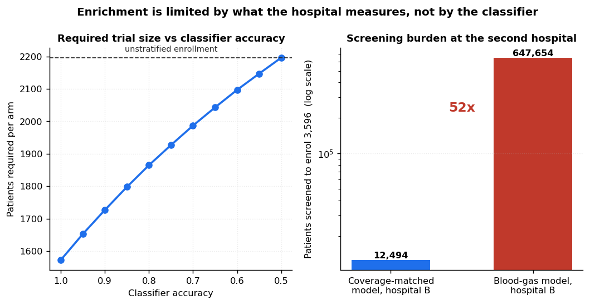
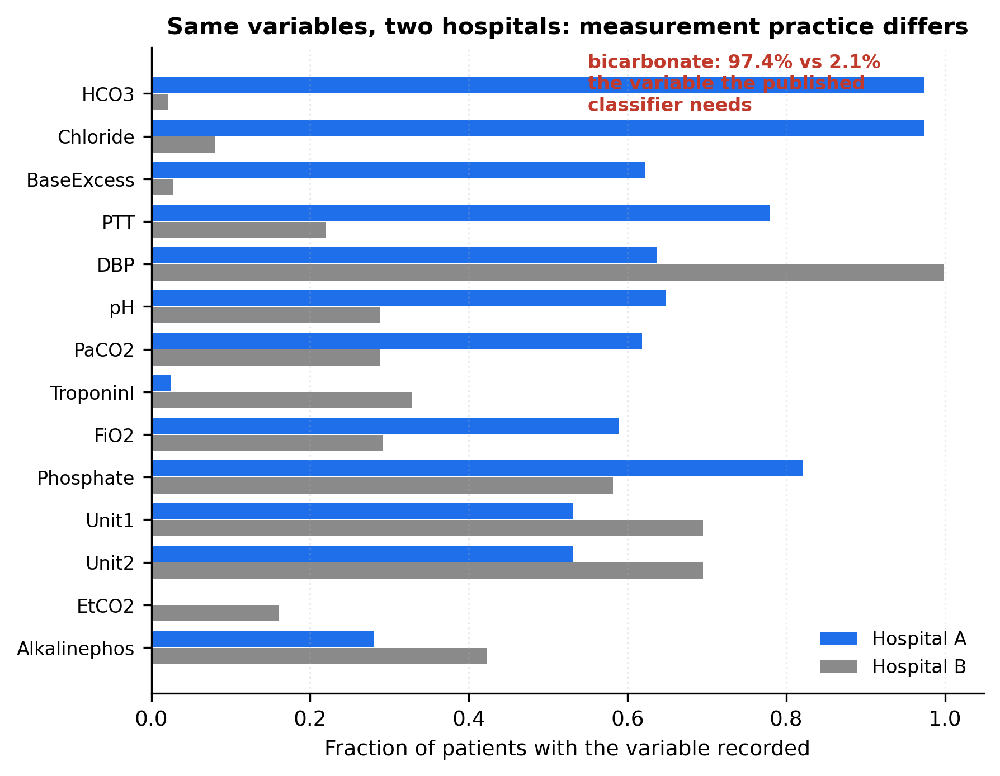
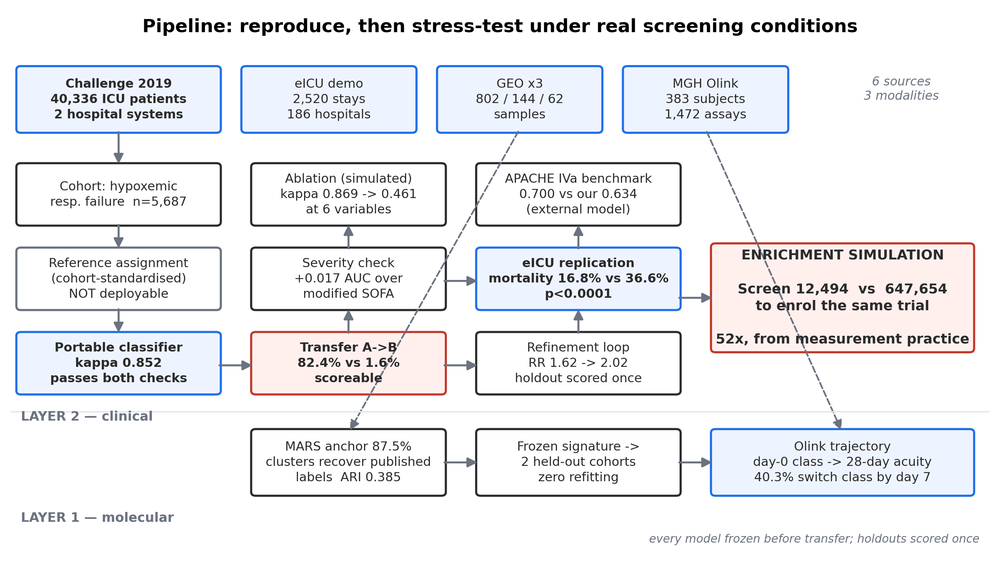
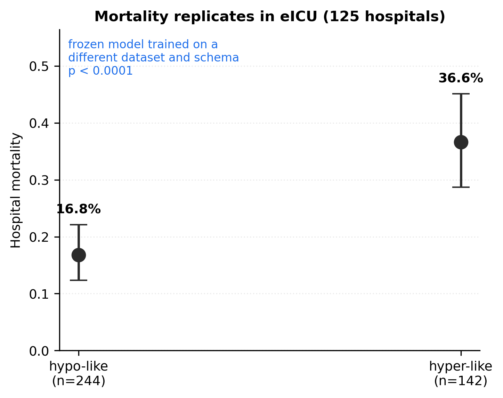
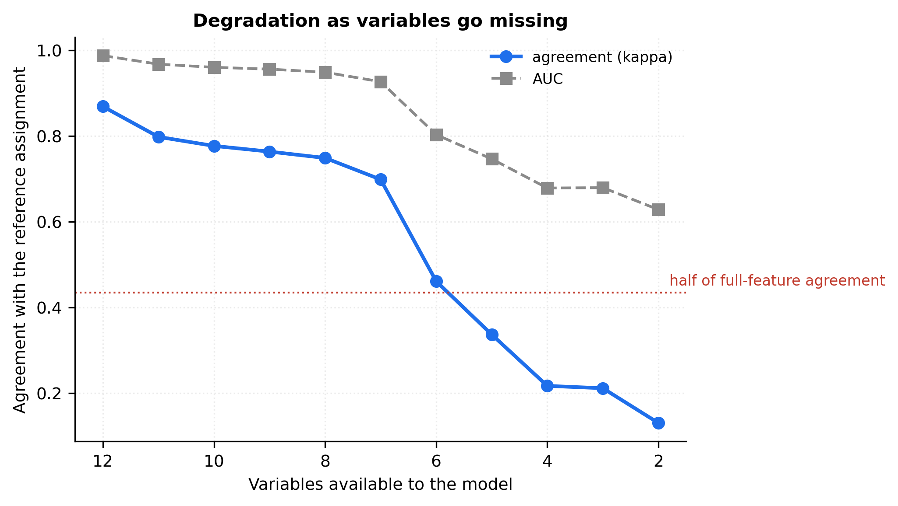

# Can you actually screen for an ARDS trial with the data a hospital really has?

**The hyperinflammatory / hypoinflammatory subphenotypes of ARDS are established and
independently replicated. This project reproduces them; it does not discover them.** They
were identified by latent class analysis of two randomised trials (Calfee et al., *Lancet
Respir Med* 2014), recovered across five or more cohorts since, shown to carry differential
mortality and treatment response, and reduced to parsimonious classifiers (Sinha et al.,
2020). Full citations in [`CITATIONS.md`](CITATIONS.md).

What is open is whether those classifiers survive contact with routine care. Every
published validation ran in curated research cohorts — ARDSNet trials, EARLI, VALID, LUNG
SAFE — where variables were measured on protocol and missingness was low by design. This
asks what happens when you take them to two real hospitals.

## The headline

**A frozen classifier scores 82.4% of patients at a second hospital using coverage-matched
variables, and 1.6% using the variables that work best.**

The most informative four-variable model is BUN, bicarbonate, creatinine and pH. Two of
those four are not recorded comparably at the second site — bicarbonate is charted for
97.4% of patients at hospital A and **2.1%** at hospital B. Translated into trial terms, to
enrol the same 3,596 patients you would screen **12,494** with the coverage-matched model
or **647,654** with the blood-gas model. A 52-fold difference in screening burden, from an
identical trial design, caused entirely by which variables a hospital routinely measures.

That is not "the model degrades." At hospital B the trial is not runnable.



*Left: required patients per arm as classifier accuracy falls, against unstratified
enrollment. Right: patients who must be screened to enrol the same trial at hospital B,
using coverage-matched variables versus the blood-gas variables. Log scale. Prognostic
enrichment only; endpoint is sepsis onset, not mortality.*



*Patient-level coverage for the variables that differ most between the two hospital
systems. The difference runs in both directions — hospital B charts diastolic pressure and
troponin more — which is why this is measurement practice rather than a data-quality defect
at one site.*

## Pipeline



*Six sources, three modalities. Every model is frozen before it crosses a dataset
boundary, and the refinement loop's holdout is scored exactly once. The two red boxes are
the result: a coverage gap between hospitals that becomes a 52-fold screening burden.*

## What the data is, and is not

- **Primary cohort:** PhysioNet/CinC Challenge 2019 — 40,336 ICU patients, hourly, from two
  hospital systems. After inclusion criteria, **5,687 patients** (4,680 / 1,007).
- **This is not an adjudicated ARDS cohort and is never called one.** No imaging, no PEEP,
  no ventilation flag, so Berlin criteria cannot be approximated. It is hypoxemic
  respiratory failure by an SpO₂/FiO₂ surrogate. A pre-commit hook enforces the wording.
- **It has no mortality outcome.** The only label is sepsis onset. Mortality comes from the
  eICU demo instead, with intervals reported wide.
- The cohort is *selected*: requiring a recorded FiO₂ picks out older, longer-stay patients
  with triple the sepsis rate (standardised differences 0.19–0.34).

## Results

**Reproduction (C1).** A Gaussian mixture on set A recovers the *directional pattern* the
published literature reports: the hyperinflammatory-like class shows all four expected
directions — lower bicarbonate, higher creatinine, higher WBC, higher event rate — at **28.5%
prevalence**, inside the 20–35% published cohorts report. It is not a comparison against the
published class *assignments*, which do not exist for these patients. BIC actually prefers k=4, which is
the maximum of the pre-registered range with BIC still falling; that is a boundary solution
and is reported as one.

**Portability (C2).** The reference model needs cohort means at inference, so it cannot be
deployed. Three replacements reproduce its labels from raw per-patient values: gradient
boosting at **κ=0.852 (AUC 0.987)**, logistic at 0.723, and a depth-4 tree at 0.671 that
reads as a bedside rule. All three pass two independent portability checks — static
introspection for fitted scalers, and a functional probe requiring each patient's
prediction to be identical alone and inside a batch.

**Generalization (C4).** Frozen set-A models applied to set B, and separately to the eICU
demo across 125 hospitals under a different schema. **The mortality gradient replicates
decisively**: 16.8% vs 36.6% hospital mortality between predicted classes, Fisher
p<0.0001, non-overlapping intervals, 2.2×. Benchmarked against APACHE IVa — a published
model whose predictions ship with the data and which I had no hand in fitting — it reaches
AUC 0.634 against APACHE's 0.700. APACHE wins, as it should: it is purpose-built for
mortality and an endotype label is not.



*Hospital mortality by predicted class in the eICU demo, 95% intervals. The model was
trained on Challenge 2019 set A and frozen; eICU is a different dataset with a different
schema across 125 hospitals.*

**Deployment stress-test (C5).** Agreement falls from κ=0.869 on 12 variables to 0.699 at
7 and 0.461 at 6, losing half its performance by 5 variables. Removal order is
least-available-first, because a real deployment loses whatever the site does not measure.
Missingness carries real but modest signal: the mask alone reaches AUC 0.546 against 0.641
for the values, and adds nothing on top of them — so the stronger conjecture that
missingness might *beat* the measurements is **not supported**.

The result that cuts against expectation: patients with **fewer** variables measured have a
*higher* sepsis rate (17.1% vs 14.1%) and are predicted *better* (AUC 0.675 vs 0.592).
Sparse data is not degraded data here — it marks a different kind of patient. Both analyses
run on the full cohort against sepsis onset, because endotype labels exist only where data
is complete and so cannot support any question *about* missingness.



*Agreement with the reference assignment as variables are removed least-available-first.
The cliff falls between 7 and 6 variables.*

**Enrichment (C8).** Prognostic enrichment only — a power calculation, not a causal claim.
Unstratified enrollment needs 2,196 per arm; perfect enrichment needs 1,573; at the
classifier's real accuracy, 1,798. The screening-burden result above is where this becomes
interesting.

**Refinement loop (C6).** One documented cycle. The error taxonomy found real failure
modes: the model is **inverted** on sparsely-measured patients (risk ratio 0.12 vs 1.71),
and the signal is carried almost entirely by patients over 65 (1.78 vs 0.98). Two
pre-specified rules fired. On a holdout scored exactly once, enrichment improved (RR
1.62→2.02, crossing into significance) while discrimination did not (AUC 0.634→0.629) —
the expected shape, since both refinements move the operating point and AUC is
threshold-invariant. See [`results/refinement_log.md`](results/refinement_log.md).

**Molecular layer (C7).** The MARS endotype labels are in GSE65682's metadata, so a
supervised anchor was possible: elastic net at **87.5% out-of-fold accuracy**, per-class AUC
0.975–0.988. Unsupervised clustering partially recovers those published labels without
seeing them (**ARI 0.385**) — though PAC stays above 0.42 at every k, so no resolution gives
a stable partition. In MGH Olink proteomics, day-0 class predicts acuity at every later
timepoint with the effect *growing* over time (Cliff's delta −0.34 → −0.51), and **40.3% of
patients change inflammatory status between day 0 and day 7** — these are states, not traits.

The frozen signature was also scored on two held-out GEO cohorts with zero refitting, on
two different array platforms. It separates sepsis-with-ARDS from sepsis alone in the
direction expected but **not significantly** (Cliff's delta +0.303, p=0.051, n=29 vs 28),
and in the longitudinal cohort the sepsis group's score rises toward the ARDS level between
day 0 and day 7 (p=0.024) while the ARDS group starts high and stays flat. Reported as the
near-null it is: the signature was derived to predict MARS endotype, not ARDS status, so
this is a demanding test rather than a failure.

## The result that constrains everything above

On Challenge 2019 the classes look nearly worthless: AUC 0.54 for sepsis onset, and only
**+0.017** over a modified SOFA — below the 0.02 threshold set before the result was seen.
On eICU the same frozen model reaches AUC 0.63 for mortality with a decisive gradient.

**The classes were not weak; the endpoint was wrong.** Sepsis onset is a 6-hour-shifted
Sepsis-3 label these subphenotypes were never derived against. Both numbers appear here
because either alone misleads.

## Limitations

- Not ARDS. Not adjudicated. No mortality in the primary cohort.
- The severity comparison uses a **modified** SOFA — no vasopressors, no GCS, bilirubin
  missing for 77% — which biases it in the endotype's favour and makes the null *stronger*.
- Set B has **zero** patients with reference labels, so no native-reference comparison
  exists there. 16 of 1,007 have the variables the reference model needs.
- The published biomarker classifier **cannot be evaluated anywhere in this data**: IL-6 and
  sTNFR1 are absent from EHR data entirely, Olink NPX is a relative scale rather than a
  concentration, and the MGH clinical file has no bicarbonate. It is implemented correctly
  and shown to be inapplicable, which is the finding.
- eICU n=386 with 93 deaths. Thin.

## What I chose not to do, and why

**Predictive enrichment** — which patients *benefit* more — needs a treatment-effect
estimate and is confounded by indication in observational data. A target-trial emulation
with negative-control outcomes would be the appropriate design. Not attempted.

**Drug–disease signature mapping** (LINCS) — out of scope, and would need the molecular
layer to be stronger than it is.

**Refitting the published classifier on NPX** — legitimate, but it would then be *my* model,
and the entire design depends on the reference being external.

## Reproduce it

```bash
conda env create -f environment.yml && conda activate ards
# follow DOWNLOADS.md — acquisition is manual and deliberate
make test    # 33 tests, including the integrity guards
make scope   # descriptive scoping
```

No data is committed. Every deviation from the original specification is logged with its
trigger in [`DECISIONS.md`](DECISIONS.md) — including four cases where a bug in my own
analysis produced a plausible result that a test or an assertion caught.
