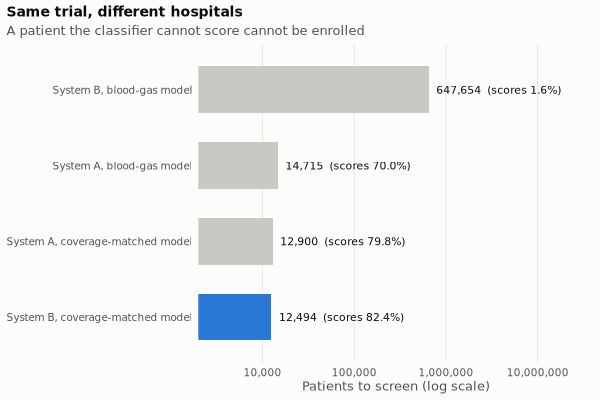

# Enrichment trial planner (R Shiny)

How many patients does a prognostically enriched trial need, and how many must a hospital **screen** to enrol them,
once you account for an imperfect classifier and for patients the classifier cannot score at that site?

An interactive front end to this repo's enrichment analysis (`../layer2_clinical/09_enrichment_simulation.py`).
**Live app: <https://jamesconde.shinyapps.io/enrichment-trial-planner/>**
Its headline at the defaults: the same 3,596-patient trial needs **12,494** screens at hospital system B with the
coverage-matched classifier, and **647,654** with the blood-gas classifier, a 52-fold difference caused only by
which labs the hospital records.



## Status (2026-10-31)

| Piece | State |
|---|---|
| Closed-form calculator (`app/R/enrichment.R`) | done; parity-tested against the real Python |
| Patient-level Monte Carlo (`app/R/simulate.R`) | done; validated against the closed form |
| Shiny app (`app/app.R`) | deployed 2026-10-31: <https://jamesconde.shinyapps.io/enrichment-trial-planner/> (confirmed working by James in a normal browser, 2026-10-31) |
| Time-to-event endpoint | not started (next) |

## Validation (`Rscript tests/run_tests.R`: 15 tests, 310 expectations, ~4 s)

| Test | What could have failed | Result | Tier |
|---|---|---|---|
| Real-path reference | `tools/export_reference.py` runs the UNMODIFIED Python `main()` (recording wrappers, output redirected to `scratch/`, DuckDB read-only) and requires its outputs to equal the committed `results/` files byte-for-byte | 3/3 identical | CHECKED |
| Parity (`test-parity.R`) | all 14 `n_per_arm` and 12 `ppv` calls of the real run; both result CSVs after the same rounding; site internals | all equal (≤ 1e-12 relative; CSVs exact) | CHECKED |
| Independent closed form (`test-closed-form.R`) | `n_per_arm` vs base R `power.prop.test` (numerical root-finding) on 128 designs; power back-substitution | all agree (< 1e-3 patients; power to 1e-10) | CHECKED |
| Monte Carlo (`test-montecarlo.R`), simulation never uses the PPV/dilution/screening formulas | power at the formula's N; screening ratio; enrolled PPV; asymmetric classifier with partial coverage | power within 3.5 MC SE of 80% in both designs; screening ratio within 1% | CHECKED |
| Negative control | sizing for perfect enrichment with a 0.70 classifier must come out underpowered | below 80% by > 3 SE, and where `power.prop.test` predicts | CHECKED |
| Type I error | no treatment effect, rejection rate = alpha | within 3.5 SE of 5% | CHECKED |

Seeds fix every Monte Carlo draw. In-app check at the defaults (1,000 trials): power 79.3% (95% CI 76.8–81.8%) vs
nominal 80%; screened per enrolled 3.475 vs 3.474 (SINGLE-RUN).

## Run it

From `trial_planner/`:

```bash
tools/serve.sh start      # http://localhost:8787   (conda env trialplanner-r; R 4.5.3, shiny 1.14)
tools/serve.sh stop
Rscript tests/run_tests.R # from the repo root, env trialplanner-r
~/miniconda/envs/ards/bin/python tools/export_reference.py   # regenerate reference + defaults from the Python analysis
Rscript tests/render_tabs.R                                  # re-render chart PNGs + an in-app simulation via testServer
```

Runs on CPU by design: closed-form maths plus a ~1 ms/trial simulation, deployable to a free Shiny host. The
in-app simulation caps itself at 3e7 screened patients per run (about 3 s).

## User guide

1. **Trial design**: alpha, power and the relative risk reduction you assume (a design input, not an estimate).
2. **Cohort**: share of patients in the high-risk class and each class's event rate. Defaults are the study
   cohort's (hypoxemic respiratory failure, not ARDS-adjudicated); while an input still shows its default, the exact unrounded value is used.
3. **Classifier**: sensitivity and specificity. Lower values dilute the enrolled event rate (see the Accuracy tab).
4. **Site**: the share of screened patients whose data the classifier can score. Presets come from the two hospital
   systems in the ARDS study; *Custom* sets your own.
5. Read the four headline boxes. **Check by simulation** re-derives power and screening by simulating whole trials;
   a red message means the nominal power fell outside the simulation's 95% interval.

**Prognostic, not predictive, enrichment**, and the default endpoint is sepsis onset, not mortality (see the About
tab). The numbers are illustrative; the method is the deliverable.

## Provenance

`app/defaults.json` and `reference/python_reference.json` carry an embedded `_provenance` block and a
`.provenance.json` sidecar, written with `molmage/src/molmage/util/provenance.py`: ards-endotypes commit `d5f5f66`,
sha256 of the script, `ards.duckdb`, `static.parquet` and `L2_transfer_results.csv`, tier CHECKED. `git_commit` is
the commit the exporter ran at; re-run it after changing the analysis.

## Open items (#Consult with James)

- **Break-even accuracy in the Python is fragile.** `break_even = curve[curve.n_per_arm >= n_unstrat]` compares a
  ROUNDED N with an UNROUNDED one. At accuracy 0.5 they are equal in exact arithmetic, so the reported 0.50 depends
  only on 2,195.57 rounding up. The port mirrors this for parity (`break_even_accuracy()`); the app does not show it.
- **The provenance tool is MolMAGE-locked** (`project` and git are hard-coded to the molmage repo). The exporter
  overrides both through `**extra`. A `repo=` parameter would make it reusable.
- **Deploy gotcha (fixed):** the first deploy crashed on start with "there is no package called 'markdown'", because
  `includeMarkdown()` loads it internally and rsconnect only bundles packages the code names. `app.R` now has
  `library(markdown)`. A deploy that exits 0 is not a working app: open the live URL and check `rsconnect::showLogs()`.
- **Redeploy** (from `trial_planner/`): `Rscript -e 'rsconnect::deployApp("app", appName = "enrichment-trial-planner", account = "jamesconde", forceUpdate = TRUE)'`
- Possible next: time-to-event endpoint (Schoenfeld events vs a log-rank simulation).
